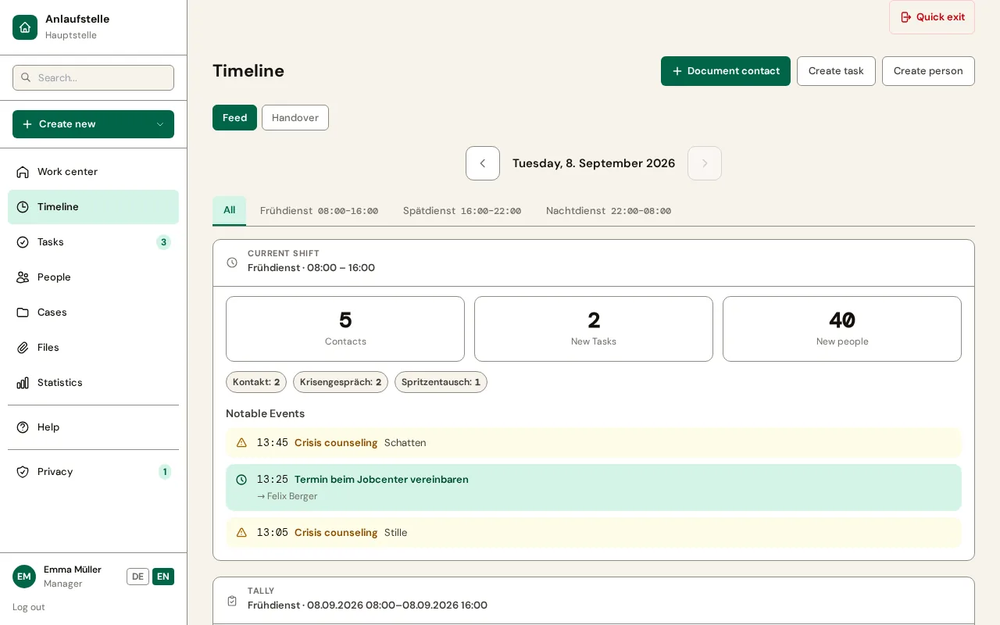
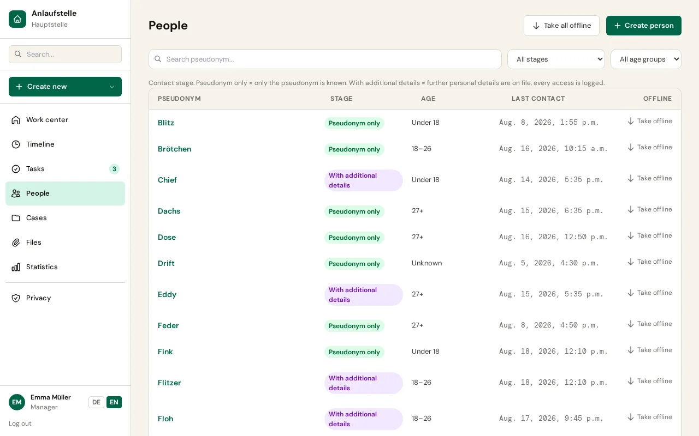
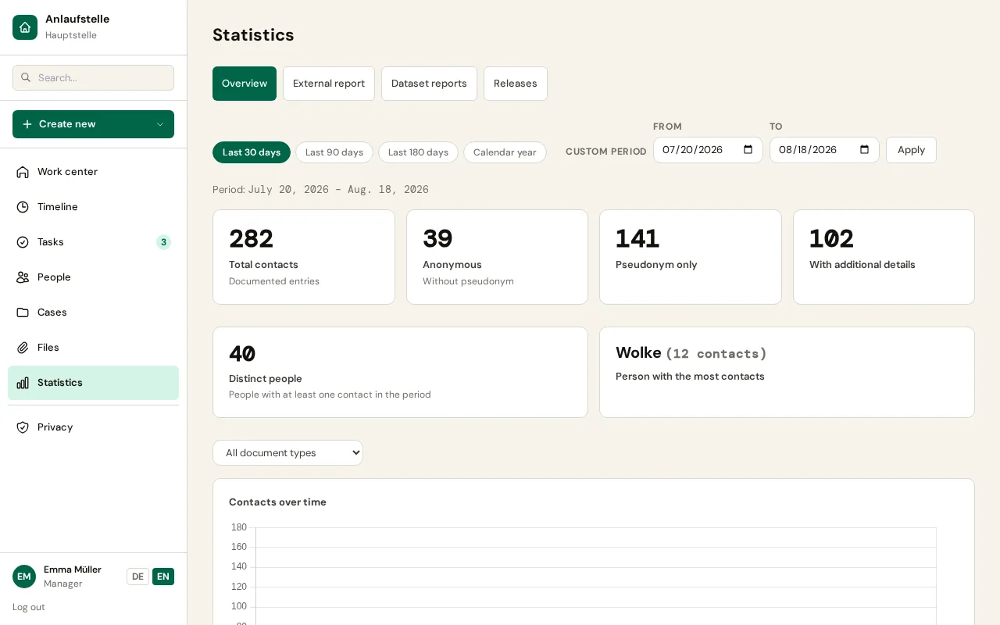
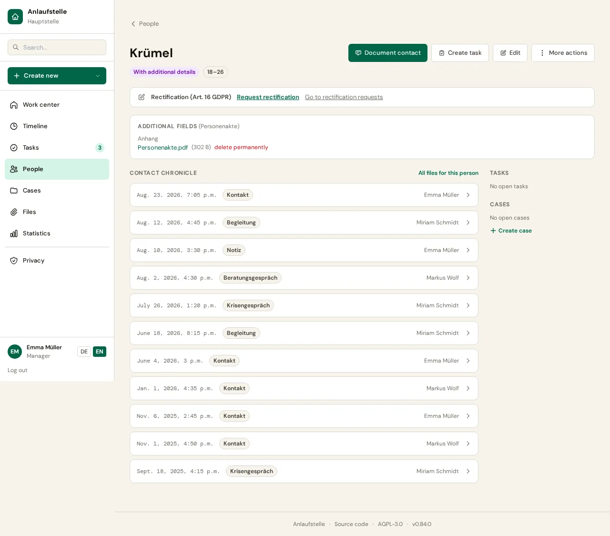
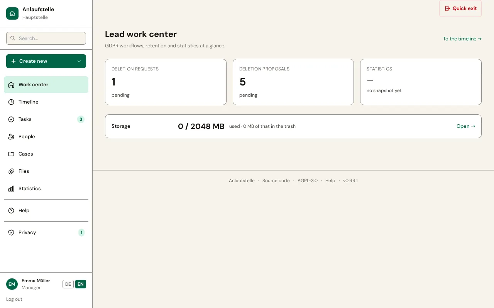
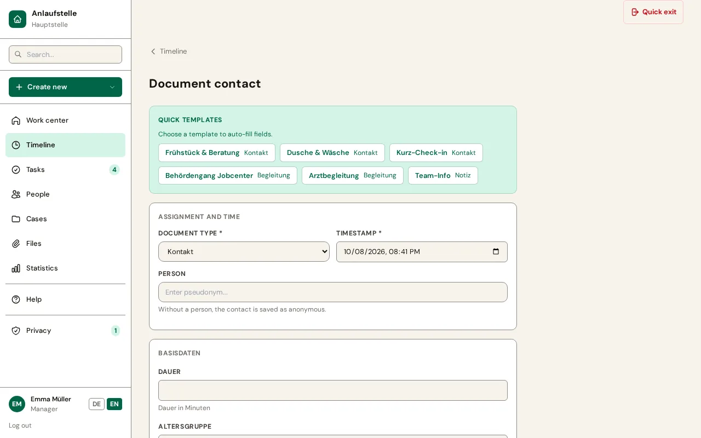
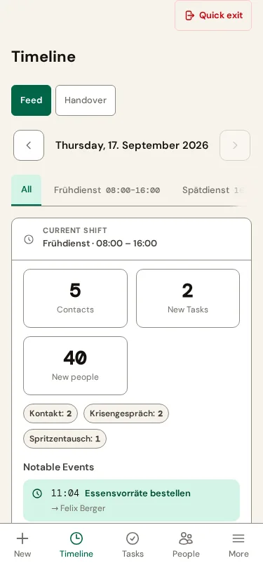
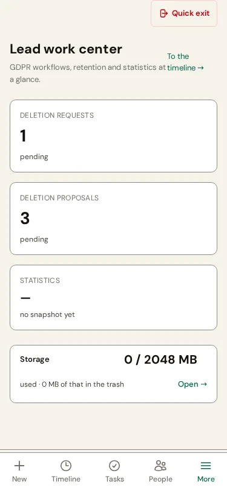

> **[Deutsche Version / German version](README.md)**

# Anlaufstelle

**Documentation, statistics, and team communication for low-threshold social work — wherever people come without an appointment and without giving their real name. Open source, pseudonymized, free — designed for privacy-compliant operation.**

> ⚠️ **Pre-Release (v0.99.8)** — Anlaufstelle is functional but not yet cleared for production use. Quality assurance and stabilization are ongoing. We are looking for pilot facilities to test and co-develop the system — [get in touch](mailto:kontakt@anlaufstelle.app).

---

## What Anlaufstelle looks like

| Timeline — your digital logbook | People list |
|:---:|:---:|
|  |  |

| Statistics at the push of a button | Person history |
|:---:|:---:|
|  |  |

| Work hub — role-based landing | Log an event |
|:---:|:---:|
|  |  |

<details>
<summary>Mobile view</summary>

| Timeline (mobile) | Work hub (mobile) |
|:---:|:---:|
|  |  |

</details>

➡️ **[See all screenshots](docs/screenshots.en.md)** — from case management and shift handover to the GDPR data package.

---

## Who is Anlaufstelle for?

Anlaufstelle is built for facilities where most contacts are anonymous or pseudonymous:

- **Open consultation hours & social counseling** — low-threshold advice centers
- **Psychosocial counseling, youth & women's services** — anonymous where needed (packages `beratungsstelle`, `jugendarbeit`, `frauenhaus`)
- **Awareness teams** — festivals, clubs, large events (package `awareness`)
- **Drop-in centers** — low-threshold addiction services
- **Street outreach / mobile work**
- **Day shelters, warming centers and emergency shelters** — homelessness support
- **Supervised consumption rooms and other low-threshold services**

Typical team size: 5–30 staff. Typical situation: documentation with logbooks, tally sheets, and spreadsheets — because suitable software is either too expensive, too complex, or not designed for anonymous contacts.

---

## What is Anlaufstelle?

Anlaufstelle is software for the daily work in low-threshold social services. It supports your team with documentation, information sharing between shifts, and the creation of reports and statistics — without requiring the people you support to provide their legal name.

Established commercial social-sector software targets large organizations, is prohibitively expensive for small facilities, and requires every person to be registered with their full name and address. Anlaufstelle fills this gap: low-threshold, affordable, and privacy-compliant.

---

## Three reasons to choose Anlaufstelle

### 1. No real names — by design

There is no name field. People are recorded under a pseudonym assigned by your team. For people, the system supports two contact stages:

- **Pseudonym only** — pseudonym assigned, person is recognizable on return
- **With additional details** — additional details recorded (e.g. age group, district)

Anonymous is not a status of a person but an event without a person (e.g. brief visits, needle exchange): no person is created and nothing is recognized. An event without a person is not automatically anonymous by content: free text, locations or attachments can make a person identifiable.

Pseudonymisation is the intended workflow: there is no required field for real names, and the workflows do without them. The software cannot technically prevent real names, though — pseudonyms, notes, free-text fields and attachments contain whatever the team enters or uploads. What matters is therefore the facility's data-entry practice.

### 2. Timeline documentation — like your logbook, but digital

The start page shows what happened most recently — just like opening the logbook at the beginning of a shift. Every contact, observation, and service is recorded as an entry in the timeline.

You can define time periods to match your operations — e.g. "Night shift 21:30–09:00" or "Morning" — and generate reports and statistics aligned precisely to your work rhythm.

### 3. Tailored to your facility — no programming required

Every facility works differently. Anlaufstelle adapts to your documentation practice: What types of contacts do you have? What services are recorded? What fields does an entry need?

This works without programming, directly in the interface — for events as well as for person and case forms. Fields can be grouped into sections, sorted, and given conditions ("show this field only when …"). A configuration can be captured as a YAML package, versioned, and applied to another facility. Four domain packages ship alongside the standard catalog (`beratungsstelle`, `awareness`, `frauenhaus`, `jugendarbeit`) — see [docs/packages.md](docs/packages.md).

The configuration also governs data protection:

- **Sensitivity level** — which data requires special protection
- **Encryption** — sensitive fields are encrypted individually
- **Retention period** — automatic deletion after a defined period
- **Statistics mapping** — which fields feed into reports

---

## What Anlaufstelle can do

### In daily work

- **Document contacts** — in 30 seconds, including from a smartphone
- **Notes and tasks** — share information between shifts, track follow-ups
- **People** — pseudonyms, contact stages, history timeline
- **Cases and trajectories** — document longer engagements with episodes, goals and milestones
- **File attachments** — documents and photos on an event, person or case; stored encrypted and virus-scanned before storage
- **Typo-tolerant search** — quickly find what you need
- **Offline mode for streetwork** — capture entries without network, encrypted on-device
- **German and English** — language switcher built in

### For management

- **Statistics and reports** — analysis at the push of a button, export as CSV, PDF, JSON and XML
- **Reporting standards as building blocks** — bundled analyses (contacts per month, case figures, counseling hours, needle-exchange balance …); further ones can be added without touching the rest of the system
- **Example activity report** — structured, customizable template (not a binding official record)
- **Data migration via CSV import** — guided wizard with mapping, dry run, and only then the commit
- **Facility export** — complete, versioned data export of one facility (Art. 20 GDPR)
- **5-tier role model** — System administration (`super_admin`), Application support (`facility_admin`), Lead, Staff, Assistant
- **Facility isolation** — data is fully separated, no mixing between locations

### Data protection and GDPR

Anlaufstelle is designed from the ground up for handling particularly sensitive data (Art. 9 GDPR):

- **Pseudonymization** — no name field in the database (Art. 25 GDPR, Privacy by Design)
- **Field encryption** — sensitive data encrypted per field with AES-128 (Art. 32 GDPR)
- **Encrypted file attachments** — file vault with AES-128 encryption and ClamAV virus scanning before storage
- **Two-factor authentication** — TOTP with backup codes, can be enforced facility-wide
- **Retention periods** — automatic deletion after configurable period (Art. 17 GDPR)
- **Deletion requests with four-eyes principle** — deletion only after approval by management/admin
- **Audit trail** — immutable log of all security-relevant actions
- **Data subject rights** — data access and export for people (Art. 15, 20 GDPR)
- **Rectifications (Art. 16 GDPR)** — as an internal request reviewed by management/admin, not as self-service
- **K-anonymity in analyses** — small cell counts are suppressed before any figures leave the facility
- **GDPR templates** — sample documents for DPA, DPIA, TOMs, records of processing, and privacy notices included

---

## Support for getting started

Anlaufstelle is open source and free to use. If you need help introducing the system in your facility, the makers of Anlaufstelle offer professional support:

- **Consulting** — from needs assessment and documentation concepts to system setup
- **Training** — team training via video conference or on-site
- **Customization** — configuration of documentation types for your facility

**Initial consultation (30 minutes) free of charge.** Contact: [kontakt@anlaufstelle.app](mailto:kontakt@anlaufstelle.app)

---

## Documentation

User manual, admin manual, and domain concept are available in the [docs/](docs/) directory.

### Production installation

Obtain the complete production source with `git clone https://github.com/anlaufstelle/app.git /opt/anlaufstelle`; individual Compose files are insufficient. Copy `.env.example` to `.env` there, fill in the mandatory values (keys, database roles, `ALLOWED_HOSTS` including `localhost,127.0.0.1` for the container health check), and run the first-time setup with `./scripts/initial-setup.sh`. The authoritative step-by-step guide — prerequisites, migration path, first sign-in via `create_super_admin`, backups, and operations — is [docs/en/admin-guide.md § 1](docs/en/admin-guide.md#1-installation-docker-compose).

Then set up the **mandatory information** (imprint, privacy policy): until then, `/impressum/` and `/datenschutzerklaerung/` return 404, because Anlaufstelle deliberately ships no boilerplate text. Setup: [docs/en/admin-guide.md § 2 "Configure Mandatory Information (Imprint/Privacy)"](docs/en/admin-guide.md#configure-mandatory-information-imprintprivacy).

Create the audit anchor once before the **first backup**: `.env.example` ships `DJANGO_AUDIT_HWM_PATH=/data/audit_hwm.json` active out of the box, but the file itself is only created by the first green run of the chain verification. Without it a backup set contains six instead of seven files, and a later recovery cannot verify the audit chain against the backed-up original. The mandatory step is described in [docs/en/admin-guide.md § 3.1 "Encrypted Database and Media Backup"](docs/en/admin-guide.md#31-encrypted-database-and-media-backup).

The quick start further down is **not** a production path: it loads demo data and deliberately binds to `127.0.0.1` only.

---

## License

Anlaufstelle is licensed under the [GNU Affero General Public License v3.0](LICENSE).

This means: the source code is free to use, modify, and redistribute — even when operated as a web service, the source code must be made available. This ensures the application remains permanently accessible to all facilities.

### Disclaimer

Anlaufstelle is provided "as is", without warranty of any kind (see [LICENSE](LICENSE), Sections 15-16). The software and its documentation do **not constitute legal advice**. Operators are solely responsible for compliance with data protection regulations (GDPR, SGB X) — in particular for data protection impact assessments, data processing agreements, and organizational measures.

> **⚠️ After installation: set up backups.** Retention enforcement, breach detection, and the remaining background jobs are handled automatically by the `cron` sidecar started through `./scripts/initial-setup.sh`. **Backups** still require a host crontab entry (the script uses `docker compose -f docker-compose.prod.yml exec` and must not have the Docker socket inside a container) — without it nothing is ever backed up, silently and without any error message. Setup and migration of existing crontabs: [docs/ops-runbook.md § 3 "Cron jobs"](docs/en/ops-runbook.md#3-cron-jobs).

---

## Development

This project uses generative AI as an integral part of the development process — as a pair programming partner, research assistant, and architecture sparring partner. The AI works under human direction. The maintainer is responsible for concept, architecture, and outcome.

The domain foundation is based on a diploma thesis on documentation in low-threshold addiction care and years of hands-on experience in social work — not on AI generation.

---

## Contributing

Contributions are welcome. Please read the [contributing guidelines](CONTRIBUTING.en.md) before opening a pull request.

How decisions are made and who is responsible for the project is documented in [GOVERNANCE.md](GOVERNANCE.md) and [MAINTAINERS.md](MAINTAINERS.md).

The project is currently maintained by one person — ongoing contributions are explicitly welcome, and the path into the maintainer team is described in [GOVERNANCE.md § Aufnahme weiterer Maintainer](GOVERNANCE.md#aufnahme-weiterer-maintainer) (German).

Report bugs and share ideas: [GitHub Issues](https://github.com/anlaufstelle/app/issues)

---

<details>
<summary><strong>For developers</strong></summary>

### Quick Start

**Prerequisites for this local development quick start:** Docker with Docker Compose. The additional mandatory installation and operating prerequisites for production are listed separately in the [admin guide](docs/en/admin-guide.md#prerequisites).

```bash
git clone https://github.com/anlaufstelle/app.git
cd app
docker compose up      # without Docker group permissions: sudo docker compose up
```

The local compose file brings up the database and the application, applies the migrations, and loads the demo facility on the first start. Neither a `.env` file nor an `ENCRYPTION_KEY` needs preparing — the local setup generates the key itself ([ADR-049](docs/adr/049-one-command-local-bootstrap.md), German). After the one-off image build the login page is available within roughly 20 seconds at [http://localhost:8000/login/](http://localhost:8000/login/); all seed accounts share the password `anlaufstelle2026` (`admin` = application support, `emma` = lead, `miriam` = staff, `superadmin` = system administration). The web service deliberately binds to `127.0.0.1` only — no LAN access. Server output: `docker compose logs -f web`.

For Tailwind watch mode (`docker compose --profile tailwind up tailwind`), local Python test runs, and the rest of the toolchain see [CONTRIBUTING.en.md § 5-Minute Quick Start](CONTRIBUTING.en.md#5-minute-quick-start-docker) and [§ Development Environment Setup](CONTRIBUTING.en.md#development-environment-setup). How the system is put together: [docs/architecture.md](docs/architecture.md) (German). The production stack (`docker-compose.prod.yml`) **never** seeds and follows the separate migration path in [docs/en/admin-guide.md § 1](docs/en/admin-guide.md).

### Tech Stack

| Component | Technology |
|---|---|
| Backend | Django 6.1+, Python 3.14 |
| Frontend | HTMX + Alpine.js + Tailwind CSS |
| Database | PostgreSQL 18 |
| Encryption | AES-128 (Fernet/MultiFernet, details in ADR-006/014) |
| Deployment | Docker Compose |
| Tests | pytest + Playwright (E2E) |
| Linting | ruff |
| CI/CD | GitHub Actions |

</details>

<!-- translation-source: README.md -->
<!-- translation-version: v0.99.8 -->
<!-- translation-date: 2026-10-23 -->
<!-- source-hash: 834cf26d4c781d263a1449efca32f40f8669ba17 -->
