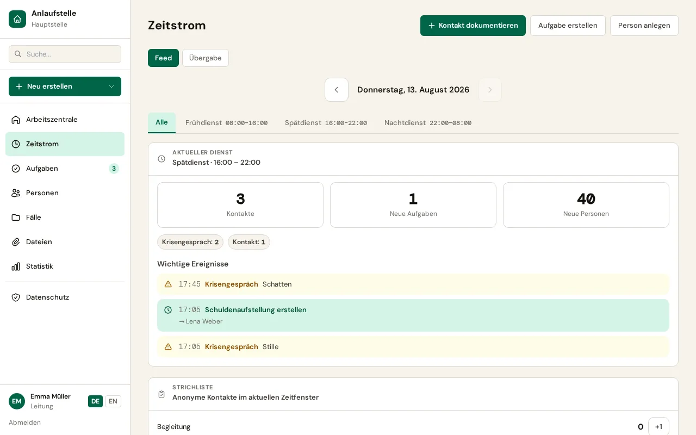
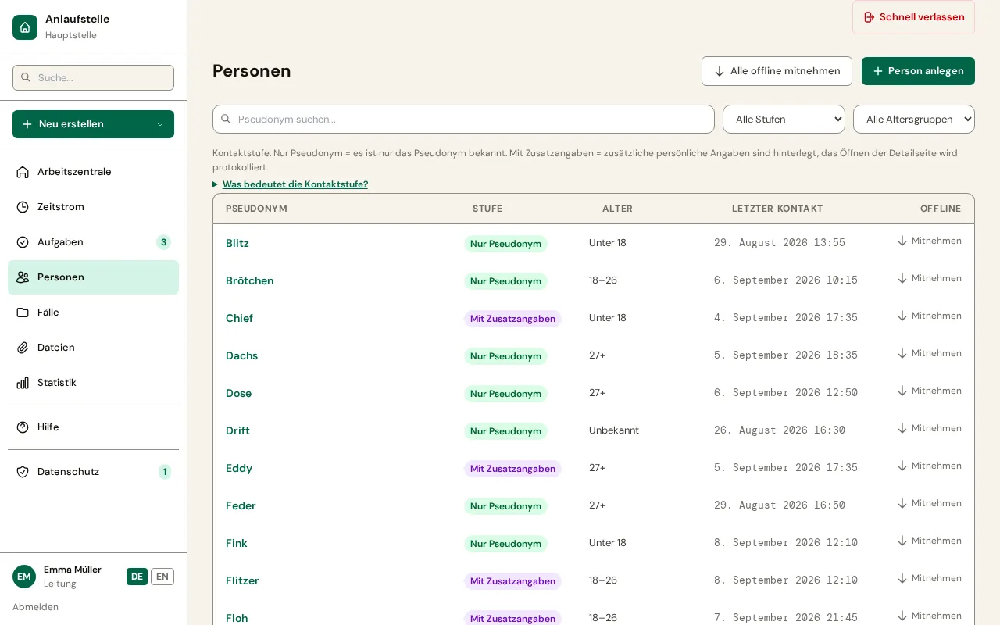
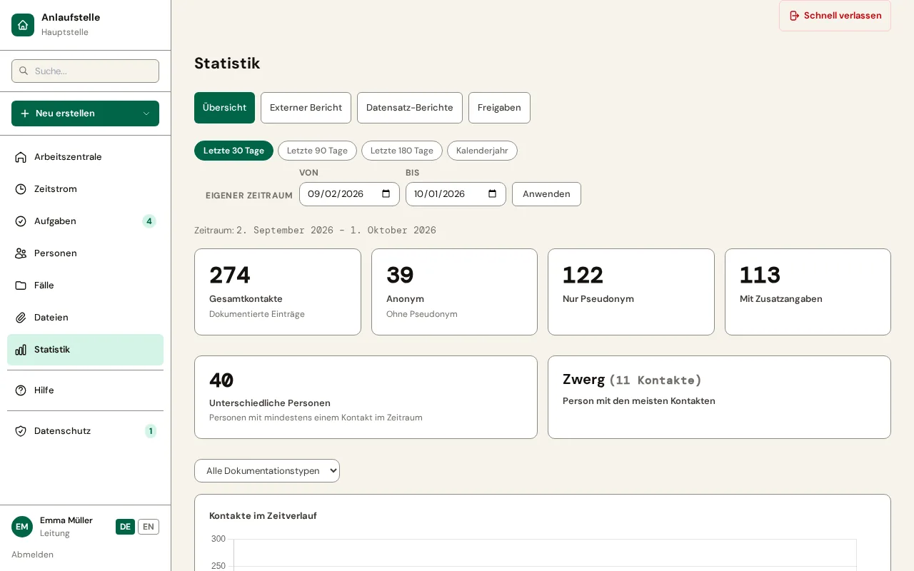
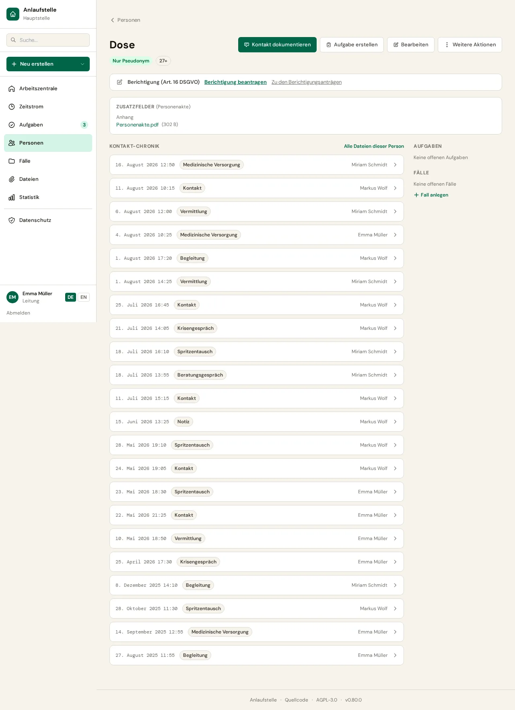
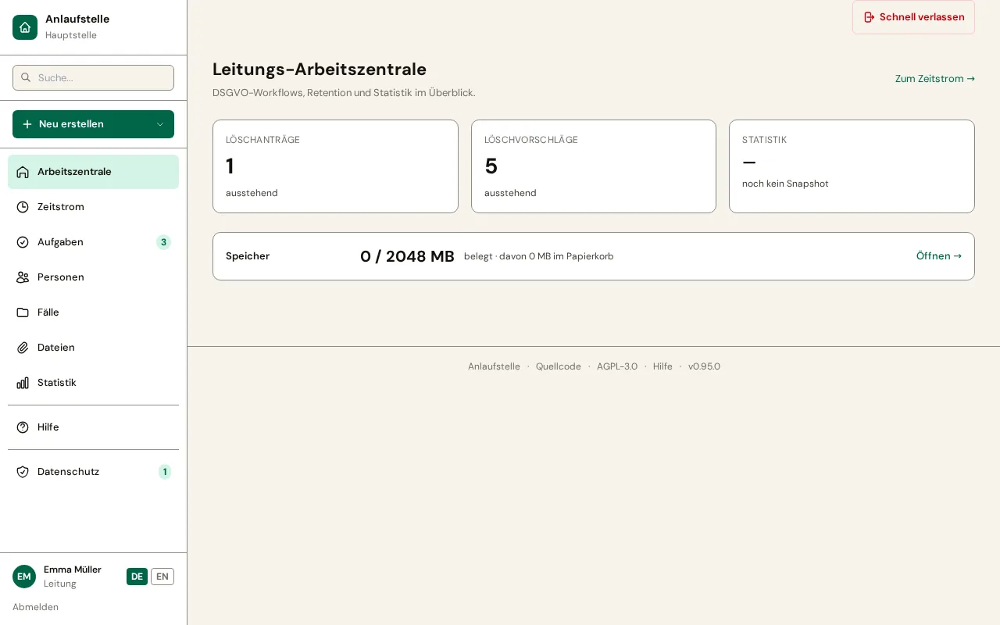
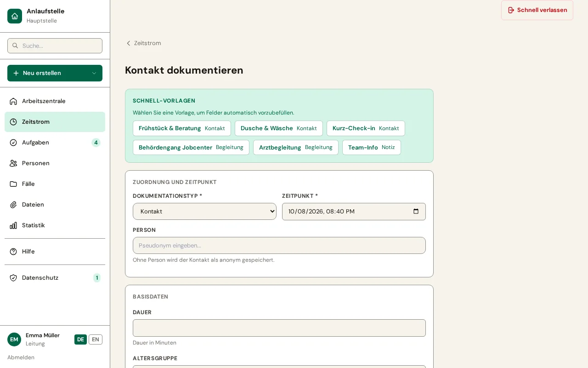
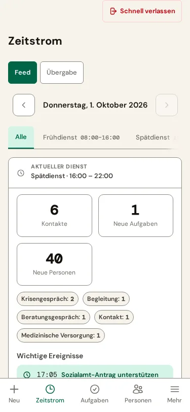
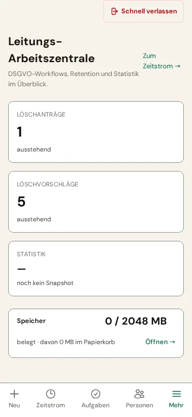

> **[English version / Englische Version](README.en.md)**

# Anlaufstelle

**Dokumentation, Statistik und Teamkommunikation für die niedrigschwellige Soziale Arbeit — überall, wo Menschen ohne Termin und ohne Klarnamen kommen. Open Source, pseudonymisiert, kostenlos — für einen datenschutzkonformen Betrieb konzipiert.**

> ⚠️ **Pre-Release (v0.99.8)** — Anlaufstelle ist funktionsfähig, aber noch nicht für den Produktiveinsatz freigegeben. Qualitätssicherung und Stabilisierung laufen. Wir suchen Piloteinrichtungen, die das System gemeinsam mit uns testen und weiterentwickeln möchten — [Kontakt aufnehmen](mailto:kontakt@anlaufstelle.app).

---

## So sieht Anlaufstelle aus

| Zeitstrom — Ihr digitales Dienstbuch | Personenliste |
|:---:|:---:|
|  |  |

| Statistiken auf Knopfdruck | Personenverlauf |
|:---:|:---:|
|  |  |

| Arbeitszentrale — rollenbezogener Einstieg | Ereignis erfassen |
|:---:|:---:|
|  |  |

<details>
<summary>Mobile Ansicht</summary>

| Zeitstrom (Mobil) | Arbeitszentrale (Mobil) |
|:---:|:---:|
|  |  |

</details>

➡️ **[Alle Screenshots ansehen](docs/screenshots.md)** — vom Fallmanagement über die Übergabe bis zum DSGVO-Datenpaket.

---

## Für wen ist Anlaufstelle?

Anlaufstelle richtet sich an Einrichtungen, in denen die Mehrzahl der Kontakte anonym oder pseudonym ist:

- **Offene Sprechstunden & Sozialberatung** — niedrigschwellige Beratungsstellen
- **Psychosoziale Beratung, Jugend- & Frauenberatung** — anonym möglich (Pakete `beratungsstelle`, `jugendarbeit`, `frauenhaus`)
- **Awareness-Teams** — Festivals, Klubs, Großveranstaltungen (Paket `awareness`)
- **Kontaktläden und Kontaktcafés** — niedrigschwellige Suchthilfe
- **Aufsuchende Arbeit / Streetwork** — mobile soziale Arbeit
- **Tagestreffs, Wärmestuben und Notschlafstellen** — Wohnungslosenhilfe
- **Konsumräume und weitere niedrigschwellige Angebote**

Typische Teamgröße: 5–30 Mitarbeitende. Typische Situation: Dokumentation mit Kladden, Zählblättern und Excel — weil passende Software entweder zu teuer, zu komplex oder nicht auf anonyme Kontakte ausgelegt ist.

---

## Was ist Anlaufstelle?

Anlaufstelle ist eine Software für die tägliche Arbeit in der niedrigschwelligen Sozialarbeit. Sie unterstützt Ihr Team bei der Dokumentation, der Informationsweitergabe zwischen Diensten und der Erstellung von Berichten und Statistiken — ohne dass Personen einen bürgerlichen Namen angeben müssen.

Etablierte kommerzielle Sozialbereichssoftware richtet sich an große Träger, ist für kleine Einrichtungen zu teuer und setzt voraus, dass jede Person mit Name und Adresse erfasst wird. Anlaufstelle füllt diese Lücke: niedrigschwellig, finanzierbar, datenschutzgerecht.

---

## Drei Gründe für Anlaufstelle

### 1. Ohne Klarnamen — von Anfang an

Es gibt kein Namensfeld. Personen werden unter einem Pseudonym geführt, das Ihr Team vergibt. Für Personen kennt das System zwei Kontaktstufen:

- **Nur Pseudonym** — Pseudonym vergeben, Person ist wiedererkennbar
- **Mit Zusatzangaben** — weitergehende Angaben (z. B. Altersgruppe, Bezirk)

Anonym ist kein Personenstatus, sondern ein Ereignis ohne Person (z. B. Kurzbesuche, Spritzentausch): Dort wird keine Person angelegt und nichts wiedererkannt. Ein Ereignis ohne Person ist aber nicht automatisch inhaltlich anonym: Freitext, Ortsangaben oder Anhänge können eine Person erkennbar machen.

Vorgesehen ist die Pseudonymisierung: Es gibt kein Pflichtfeld für Klarnamen, und die Arbeitsabläufe kommen ohne aus. Technisch verhindern kann die Software Klarnamen aber nicht — Pseudonym, Notizen, Freitextfelder und Anhänge enthalten, was das Team einträgt oder hochlädt. Entscheidend ist deshalb die Eingabepraxis der Einrichtung.

### 2. Dokumentation im Zeitstrom — wie Ihr Dienstbuch, nur digital

Die Startseite zeigt, was zuletzt passiert ist — genau wie ein Blick in die Kladde bei Dienstbeginn. Jeder Kontakt, jede Beobachtung, jede Leistung wird als Eintrag im Zeitstrom festgehalten.

Sie können Zeiträume passend zu Ihrem Betrieb definieren — z. B. „Nachtdienst 21:30–09:00" oder „Vormittag" — und Berichte und Statistiken exakt auf Ihren Arbeitsrhythmus zuschneiden.

### 3. Passend für Ihre Einrichtung — ohne Programmierung

Jede Einrichtung arbeitet anders. Anlaufstelle lässt sich an Ihre Dokumentationspraxis anpassen: Welche Kontaktarten gibt es? Welche Leistungen werden erfasst? Welche Felder braucht ein Eintrag?

Das geht ohne Programmierung, direkt in der Oberfläche — für Ereignisse ebenso wie für Personen- und Fallformulare. Felder lassen sich zu Abschnitten gruppieren, sortieren und mit Bedingungen versehen („zeige das Feld nur, wenn …"). Eine Konfiguration lässt sich als YAML-Paket festhalten, versionieren und in einer weiteren Einrichtung wieder einspielen. Mitgeliefert werden vier Domänen-Pakete (Beratungsstelle, Awareness, Frauenhaus, Jugendarbeit) neben dem Standardkatalog — siehe [docs/packages.md](docs/packages.md).

Die Konfiguration bestimmt auch den Datenschutz:

- **Sensibilitätsstufe** — welche Angaben besonders schützenswürdig sind
- **Verschlüsselung** — sensible Felder werden einzeln verschlüsselt gespeichert
- **Aufbewahrungsfrist** — automatische Löschung nach einer festgelegten Frist
- **Statistikzuordnung** — welche Felder in Berichte einfließen

---

## Was Anlaufstelle kann

### Im Arbeitsalltag

- **Kontakte dokumentieren** — in 30 Sekunden, auch vom Smartphone
- **Hinweise und Aufgaben** — Informationen zwischen Diensten weitergeben, Aufgaben nachverfolgen
- **Personen-Register** — Pseudonyme, Kontaktstufen, Verlaufschronik
- **Fälle und Verläufe** — längere Begleitungen mit Episoden, Zielen und Meilensteinen dokumentieren
- **Dateianhänge** — Dokumente und Fotos an Ereignis, Person oder Fall; verschlüsselt abgelegt und vor der Ablage auf Viren geprüft
- **Tippfehler-tolerante Suche** — schnell finden, was Sie suchen
- **Offline-Modus für Streetwork** — Erfassung auch ohne Netz, lokal verschlüsselt
- **Deutsch und Englisch** — Sprachumschaltung im System

### Für Leitung und Träger

- **Statistiken und Berichte** — Auswertungen auf Knopfdruck, Export als CSV, PDF, JSON und XML
- **Berichtsstandards als Bausteine** — mitgelieferte Auswertungen (Kontakte je Monat, Fallzahlen, Beratungszeiten, Spritzentausch-Bilanz …); weitere lassen sich ergänzen, ohne den Rest des Systems anzufassen
- **Beispiel-Sachbericht** — strukturierte, anpassbare Vorlage (kein verbindlicher Behördennachweis)
- **Datenübernahme per CSV-Import** — geführter Assistent mit Zuordnung, Probelauf und erst dann Übernahme
- **Einrichtungs-Export** — vollständiger, versionierter Datenexport einer Einrichtung (Art. 20 DSGVO)
- **5-Stufen-Rollenmodell** — Systemadministration (`super_admin`), Anwendungsbetreuung (`facility_admin`), Leitung, Fachkraft, Assistenz
- **Einrichtungstrennung** — Daten sind vollständig getrennt, kein Datenmix zwischen Standorten

### Datenschutz und DSGVO

Anlaufstelle ist von Grund auf für den Umgang mit besonders schützenswerten Daten (Art. 9 DSGVO) konzipiert:

- **Pseudonymisierung** — kein Namensfeld in der Datenbank (Art. 25 DSGVO, Privacy by Design)
- **Feldverschlüsselung** — sensible Angaben werden einzeln mit AES-128 verschlüsselt (Art. 32 DSGVO)
- **Verschlüsselte Dateianhänge** — File Vault mit AES-128-Verschlüsselung und ClamAV-Virenscan vor der Ablage
- **Zwei-Faktor-Authentifizierung** — TOTP mit Backup-Codes, einrichtungsweite Erzwingung möglich
- **Aufbewahrungsfristen** — automatische Löschung nach konfigurierbarer Frist (Art. 17 DSGVO)
- **Löschanträge mit 4-Augen-Prinzip** — Löschung nur nach Genehmigung durch Leitung/Admin
- **Prüfprotokoll** — unveränderliches Audit-Log aller sicherheitsrelevanten Aktionen
- **Betroffenenrechte** — Datenauskunft und -export für Personen (Art. 15, 20 DSGVO)
- **Berichtigungen (Art. 16 DSGVO)** — als interner Antrag mit Prüfung durch Leitung/Admin, nicht als Self-Service
- **K-Anonymität in Auswertungen** — Kleinstfallzahlen werden unterdrückt, bevor Zahlen die Einrichtung verlassen
- **DSGVO-Vorlagen** — Muster für AV-Vertrag, DSFA, TOMs, Verarbeitungsverzeichnis und Informationspflichten mitgeliefert

---

## Unterstützung bei der Einführung

Anlaufstelle ist Open Source und kostenlos nutzbar. Wenn Sie Hilfe bei der Einführung in Ihrer Einrichtung benötigen, bieten die Macher von Anlaufstelle professionelle Unterstützung an:

- **Beratung** — von der Bedarfsanalyse über Dokumentationskonzepte bis zur Einrichtung des Systems
- **Schulung** — Teamschulungen per Videokonferenz oder vor Ort
- **Anpassung** — Konfiguration der Dokumentationstypen für Ihre Einrichtung

**Erstgespräch (30 Minuten) kostenlos.** Kontakt: [kontakt@anlaufstelle.app](mailto:kontakt@anlaufstelle.app)

---

## Dokumentation

Benutzerhandbuch, Admin-Handbuch und Fachkonzept finden Sie im [docs/](docs/)-Verzeichnis.

### Produktiv installieren

Beziehen Sie den vollständigen Produktionsstand per `git clone https://github.com/anlaufstelle/app.git /opt/anlaufstelle`; einzelne Compose-Dateien reichen nicht aus. Kopieren Sie dort `.env.example` nach `.env`, setzen Sie die Pflichtwerte (Schlüssel, Datenbank-Rollen, `ALLOWED_HOSTS` samt `localhost,127.0.0.1` für den Container-Healthcheck) und starten Sie die Erstinbetriebnahme mit `./scripts/initial-setup.sh`. Den maßgeblichen Schritt-für-Schritt-Weg — Voraussetzungen, Migrationspfad, Erstanmeldung über `create_super_admin`, Backup und Betrieb — beschreibt [docs/admin-guide.md § 1](docs/admin-guide.md#1-installation-docker-compose).

Hinterlegen Sie danach die **Pflichtangaben** (Impressum, Datenschutzerklärung): Bis dahin liefern `/impressum/` und `/datenschutzerklaerung/` 404, weil Anlaufstelle bewusst keine Mustertexte ausliefert. Einrichtung: [docs/admin-guide.md § 2 „Pflichtangaben (Impressum/Datenschutz) einrichten"](docs/admin-guide.md#pflichtangaben-impressumdatenschutz-einrichten).

Legen Sie vor dem **ersten Backup** einmalig den Audit-Anker an: `.env.example` liefert `DJANGO_AUDIT_HWM_PATH=/data/audit_hwm.json` ab Werk aktiv aus, die Datei selbst entsteht aber erst mit dem ersten grünen Lauf der Ketten-Verifikation. Ohne sie enthält der Backup-Satz sechs statt sieben Dateien und die Wiederherstellung kann die Audit-Kette später nicht gegen das gesicherte Original prüfen. Der Pflichtschritt steht in [docs/admin-guide.md § 3.1 „Verschlüsselte Datenbank- und Mediensicherung"](docs/admin-guide.md#31-verschlüsselte-datenbank--und-mediensicherung).

Der Quick-Start weiter unten ist **kein** Produktionsweg: Er lädt Demodaten und bindet bewusst nur auf `127.0.0.1`.

---

## Lizenz

Anlaufstelle steht unter der [GNU Affero General Public License v3.0](LICENSE).

Das bedeutet: Der Quellcode ist frei nutzbar, veränderbar und weiterzugeben — auch für den Betrieb als Webdienst muss der Quellcode offengelegt werden. Damit bleibt die Anwendung dauerhaft für alle Einrichtungen zugänglich.

### Haftungsausschluss

Anlaufstelle wird ohne Mängelgewähr bereitgestellt, ohne Gewährleistung jeglicher Art (siehe [LICENSE](LICENSE), §15–16). Die Software und ihre Dokumentation stellen **keine Rechtsberatung** dar. Betreiber sind eigenverantwortlich für die Einhaltung datenschutzrechtlicher Pflichten (DSGVO, SGB X) — insbesondere für Datenschutz-Folgenabschätzung, Auftragsverarbeitungsverträge und organisatorische Maßnahmen.

> **⚠️ Nach der Installation: Backup einrichten.** Aufbewahrungsfristen, Breach-Detection und die übrigen Hintergrundjobs erledigt der mit `./scripts/initial-setup.sh` gestartete `cron`-Sidecar von selbst. Das **Backup** braucht weiterhin einen Host-Crontab-Eintrag (das Skript setzt `docker compose -f docker-compose.prod.yml exec` ein und darf den Docker-Socket nicht im Container haben) — ohne ihn wird nie gesichert, still und ohne Fehlermeldung. Einrichtung und Migration bestehender Crontabs: [docs/ops-runbook.md § 3 „Cron-Jobs"](docs/ops-runbook.md#3-cron-jobs).

---

## Entwicklung

Dieses Projekt nutzt generative AI als integralen Bestandteil des Entwicklungsprozesses — als Pair-Programming-Partner, Research-Assistent und Architektur-Sparringspartner. Die AI arbeitet unter menschlicher Anleitung. Der Maintainer verantwortet Konzept, Architektur und Ergebnis.

Das fachliche Fundament basiert auf einer Diplomarbeit zur Dokumentation in der niedrigschwelligen Suchthilfe und jahrelanger Praxiserfahrung in der Sozialen Arbeit — nicht auf AI-Generierung.

---

## Mitwirken

Beiträge sind willkommen. Bitte lies zuerst die [Contributing-Richtlinien](CONTRIBUTING.md), bevor du einen Pull Request öffnest.

Wie Entscheidungen getroffen werden und wer das Projekt verantwortet, steht in [GOVERNANCE.md](GOVERNANCE.md) und [MAINTAINERS.md](MAINTAINERS.md).

Das Projekt wird derzeit von einer Person gepflegt — dauerhafte Mitarbeit ist ausdrücklich erwünscht, und der Weg ins Maintainer-Team steht in [GOVERNANCE.md § Aufnahme weiterer Maintainer](GOVERNANCE.md#aufnahme-weiterer-maintainer).

Fehler melden und Ideen einbringen: [GitHub Issues](https://github.com/anlaufstelle/app/issues)

---

<details>
<summary><strong>Für Entwickler</strong></summary>

### Quick-Start

**Voraussetzungen für diesen lokalen Entwicklungs-Quick-Start:** Docker mit Docker Compose. Die zusätzlichen zwingenden Installations- und Betriebsvoraussetzungen des Produktionswegs stehen getrennt im [Admin-Handbuch](docs/admin-guide.md#voraussetzungen).

```bash
git clone https://github.com/anlaufstelle/app.git
cd app
docker compose up      # ohne Docker-Gruppenrechte: sudo docker compose up
```

Das lokale Compose bringt Datenbank und Anwendung mit, wendet die Migrationen an und lädt beim ersten Start die Demo-Einrichtung. Weder eine `.env` noch ein `ENCRYPTION_KEY` sind vorzubereiten — den Schlüssel erzeugt das lokale Setup selbst ([ADR-049](docs/adr/049-one-command-local-bootstrap.md)). Nach dem einmaligen Image-Bau ist die Anmeldung binnen rund 20 Sekunden unter [http://localhost:8000/login/](http://localhost:8000/login/) erreichbar; alle Seed-Konten teilen sich das Passwort `anlaufstelle2026` (`admin` = Anwendungsbetreuung, `emma` = Leitung, `miriam` = Fachkraft, `superadmin` = Systemadministration). Der Webdienst bindet dabei bewusst nur auf `127.0.0.1` — kein LAN-Zugriff. Serverausgabe: `docker compose logs -f web`.

Für Tailwind im Watch-Modus (`docker compose --profile tailwind up tailwind`), den lokalen Python-Testlauf und den Rest der Werkzeugkette: [CONTRIBUTING.md § 5-Minuten-Quick-Start](CONTRIBUTING.md#5-minuten-quick-start-docker) und [§ Entwicklungsumgebung einrichten](CONTRIBUTING.md#entwicklungsumgebung-einrichten). Wie das System aufgebaut ist: [docs/architecture.md](docs/architecture.md). Der produktive Stack (`docker-compose.prod.yml`) seedet **nie** und folgt dem getrennten Migrationspfad aus [docs/admin-guide.md § 1](docs/admin-guide.md).

### Tech-Stack

| Komponente | Technologie |
|---|---|
| Backend | Django 6.1+, Python 3.14 |
| Frontend | HTMX + Alpine.js + Tailwind CSS |
| Datenbank | PostgreSQL 18 |
| Verschlüsselung | AES-128 (Fernet/MultiFernet, Detail in ADR-006/014) |
| Deployment | Docker Compose |
| Tests | pytest + Playwright (E2E) |
| Linting | ruff |
| CI/CD | GitHub Actions |

</details>
