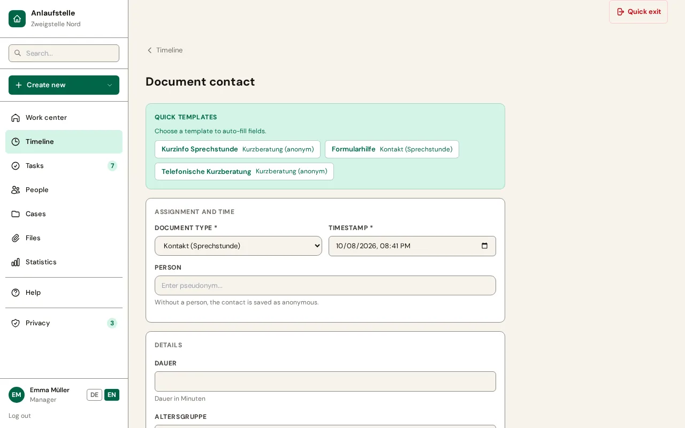
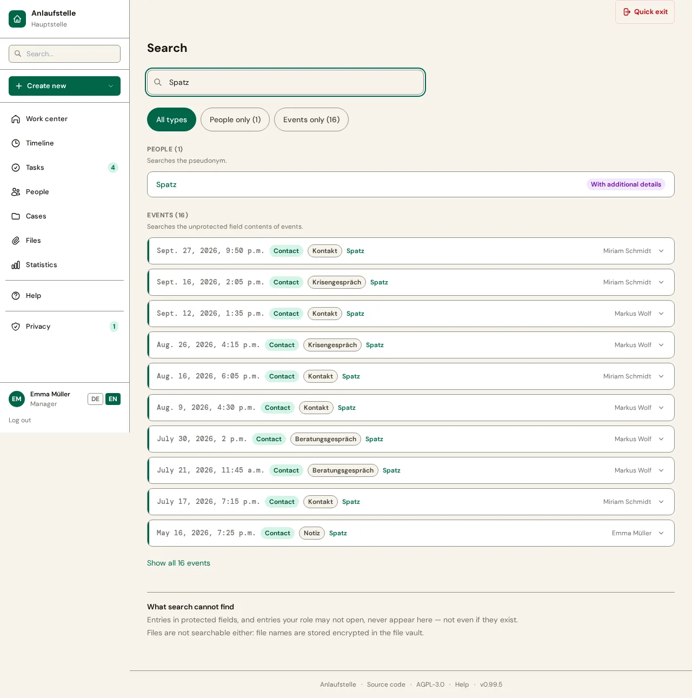
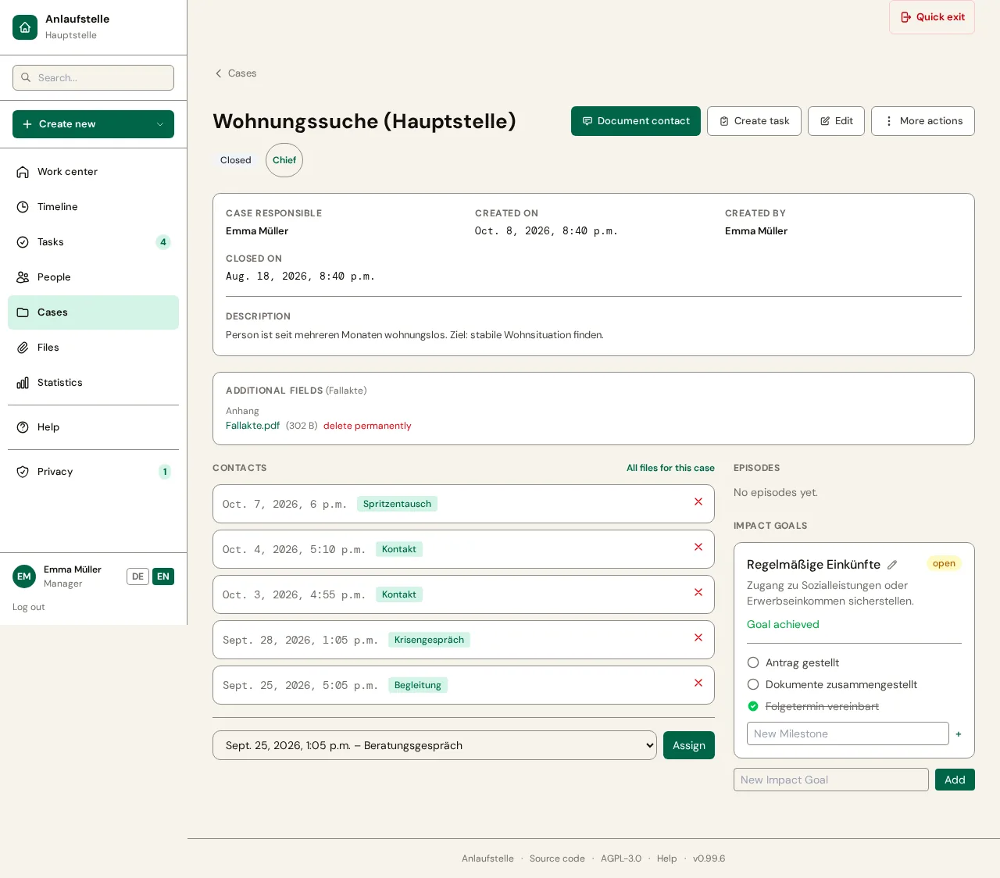
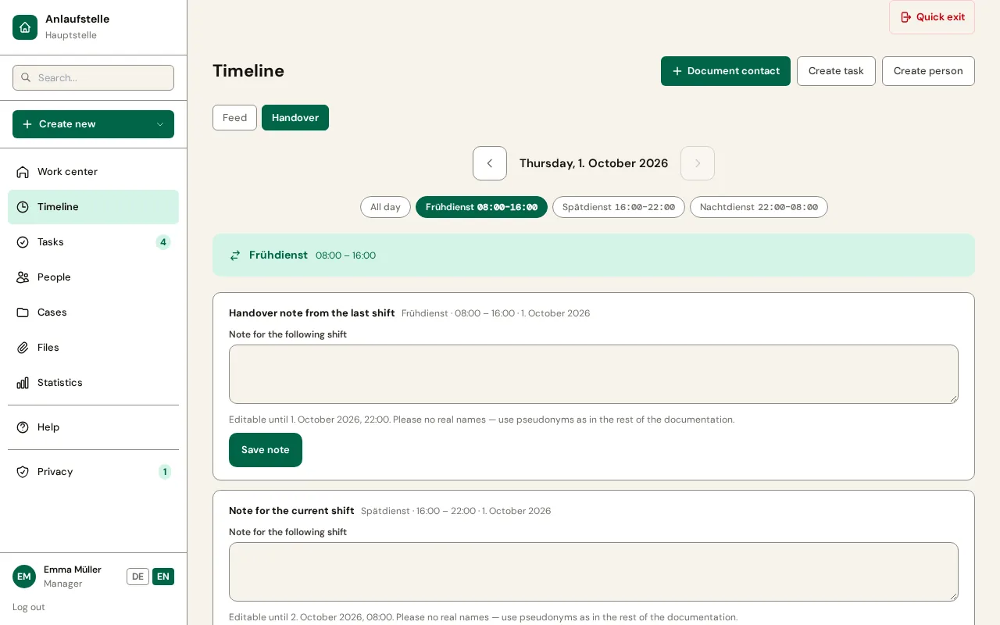
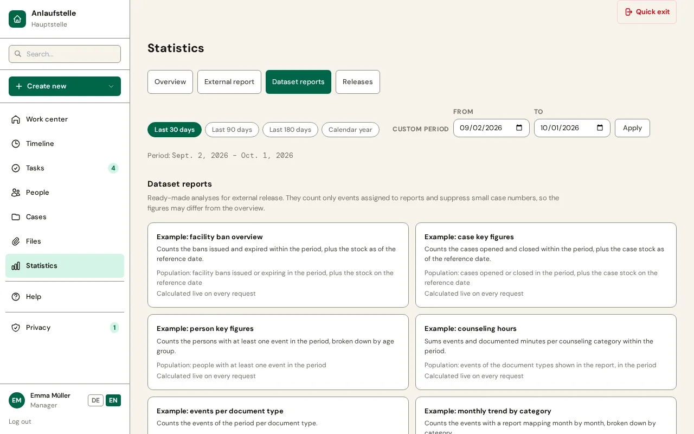
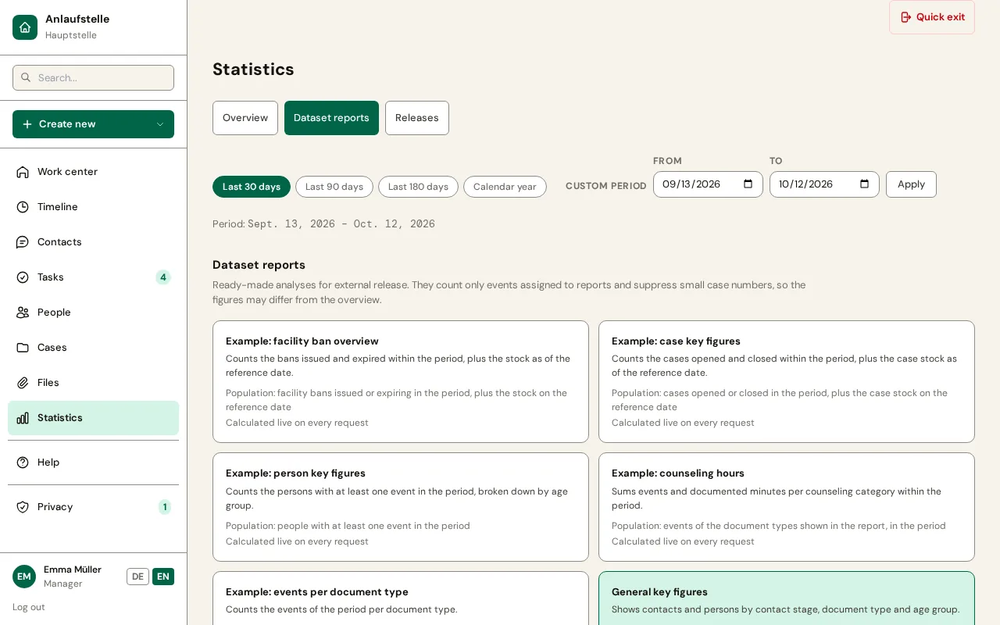
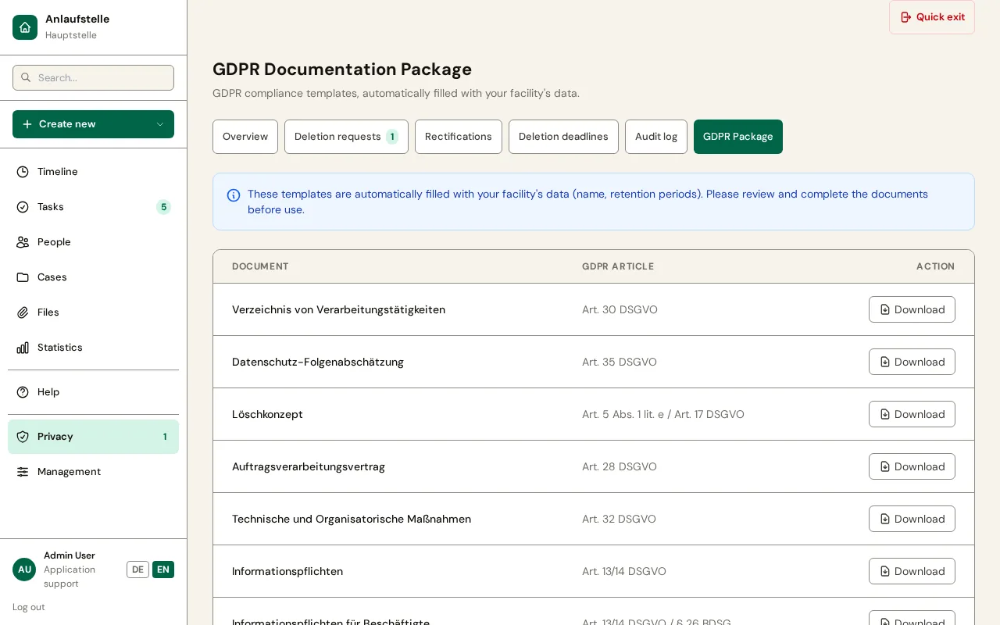
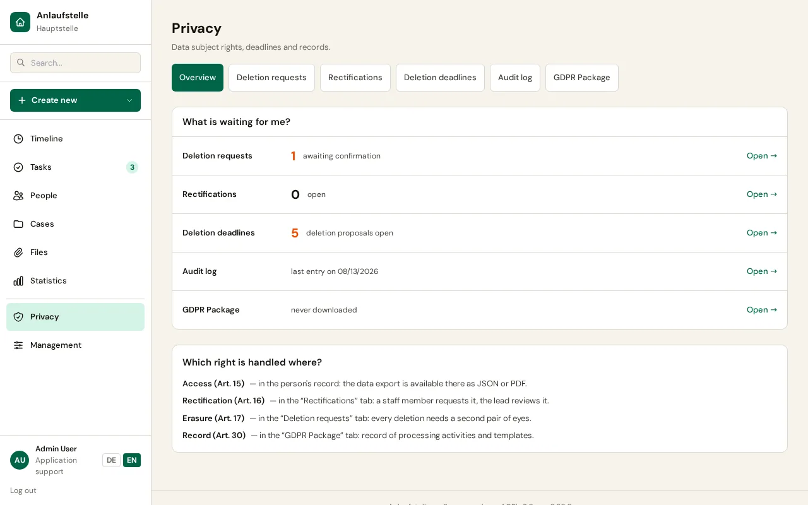
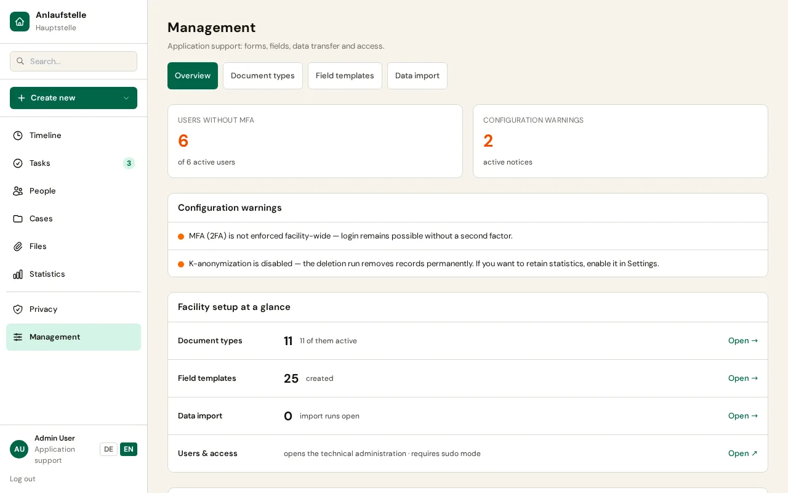
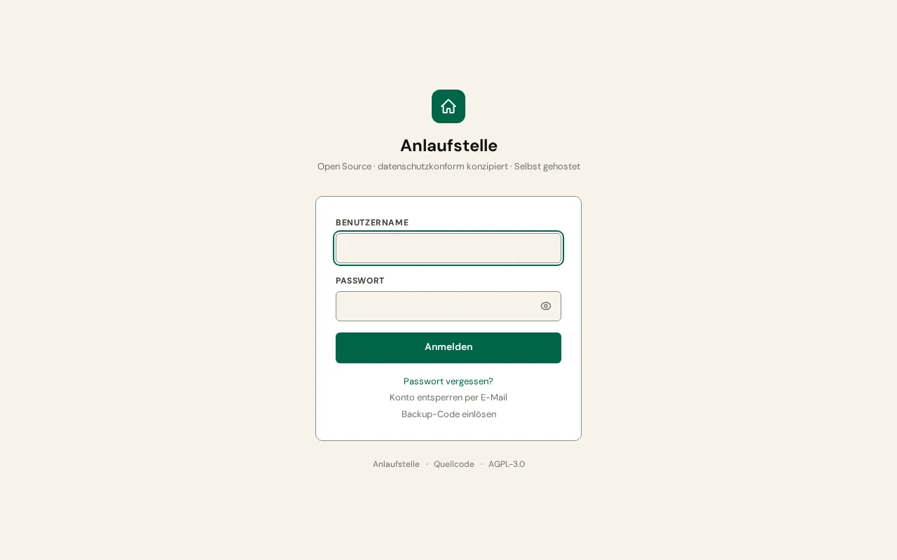

# Screenshots — Anlaufstelle

> **[Deutsche Version](screenshots.md)** · back to the [README](../README.en.md)

A full tour of Anlaufstelle. All images come from the demo environment
(`make seed --scale=medium`) and show pseudonymised sample data only. The demo
environment carries two facilities, each with its own catalogue: the main
facility (standard catalogue / drop-in centre) and "Zweigstelle Nord"
(package `beratungsstelle`, an open counselling service
[`docs/packages-beratungsstelle.md`](packages-beratungsstelle.md), German only).
`--scale=large` adds three more facilities with the packages `awareness`,
`jugendarbeit` and `frauenhaus`.

## Daily work & documentation

### Timeline — the digital logbook

### Log an event

### Log an event — counselling-service package

Type selection for short counselling / counselling session / crisis session /
accompaniment from the counselling-service package (Zweigstelle Nord).

### Client list

### Client history

### Search — the full results page

## Case work

### Case file with episodes and goals

### Shift handover

### Work hub — role-based landing

## Reporting & data protection

### Statistics

### Dataset reports — ready-made exports as cards

### Privacy-friendly external report

### GDPR data package

## Area overviews

### Privacy — data-subject rights, deadlines and records

### Administration — forms, fields, data import

## Access

### Sign in

## Mobile

| Timeline (mobile) | Work hub (mobile) |
|:---:|:---:|
|  |  |
