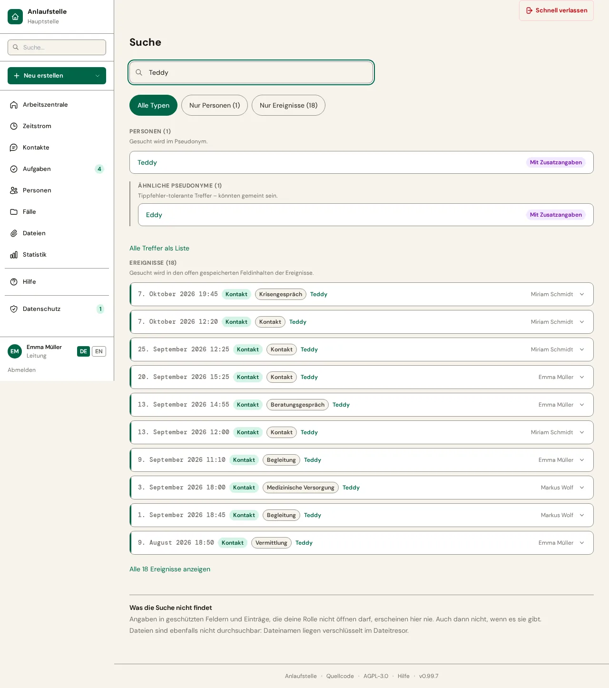
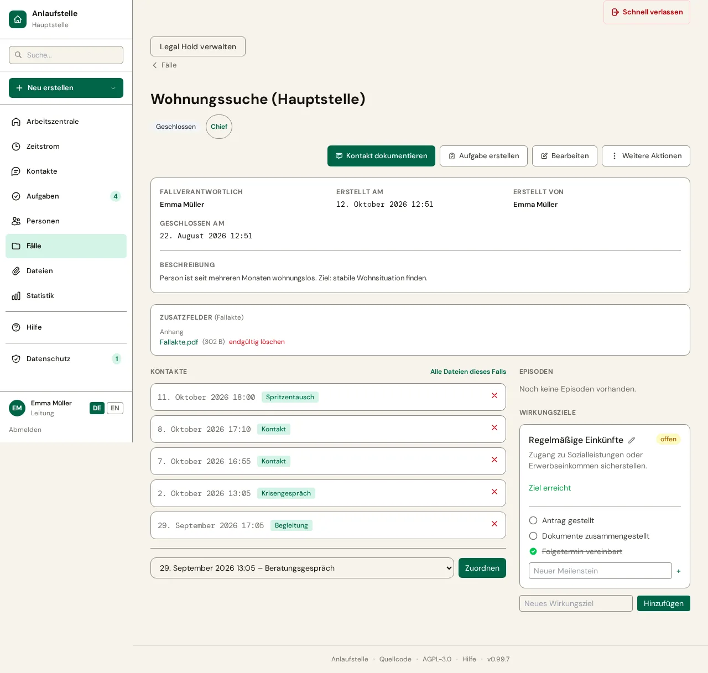
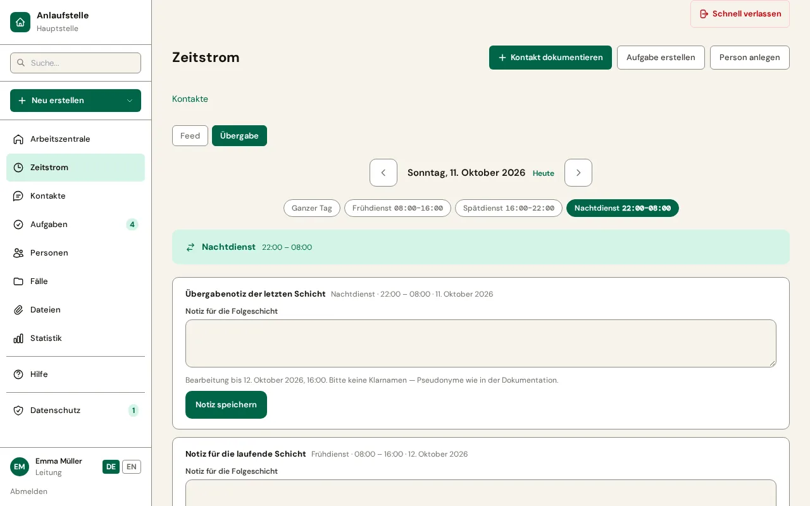
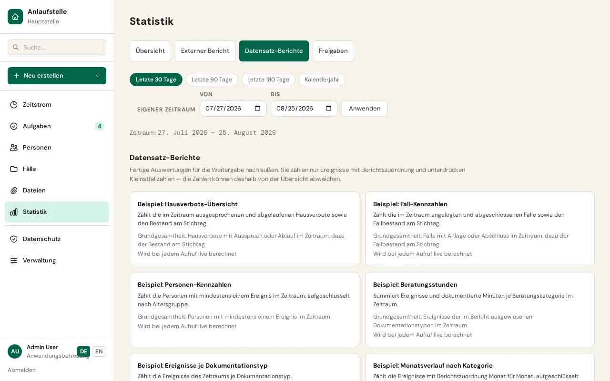
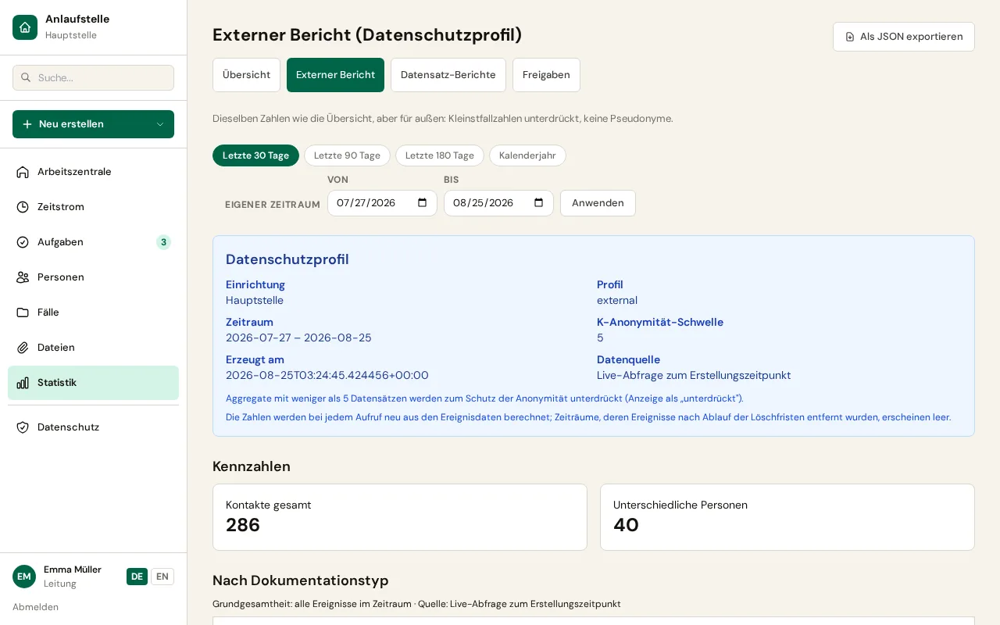
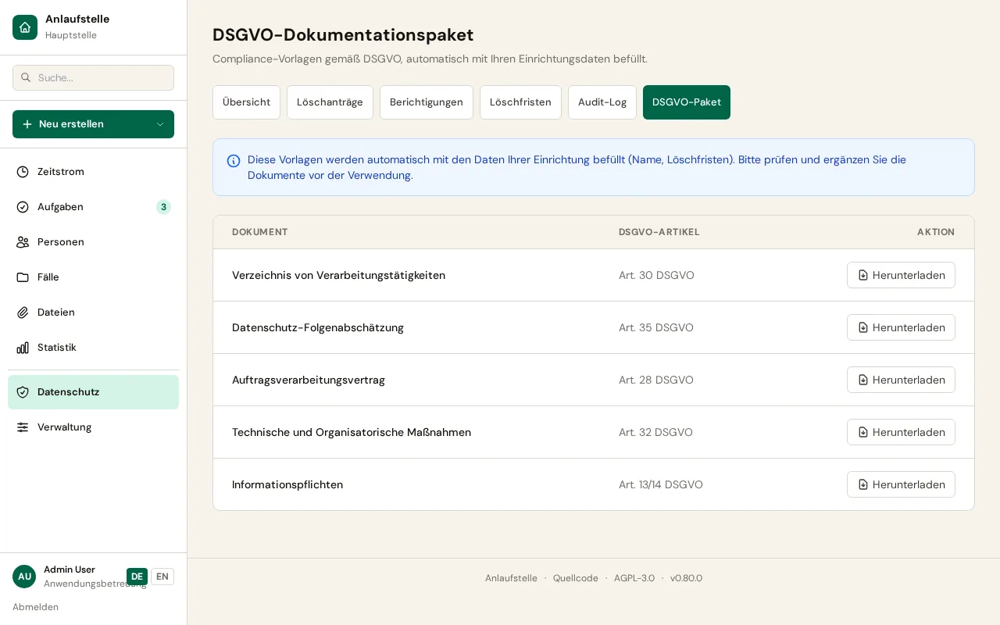
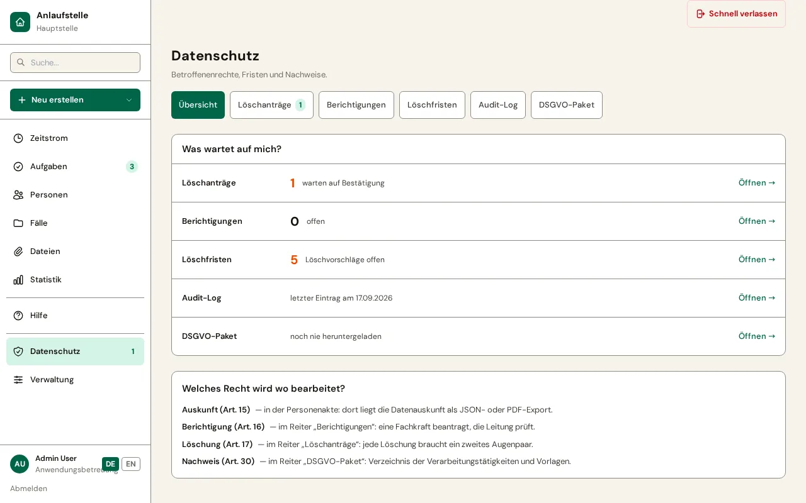
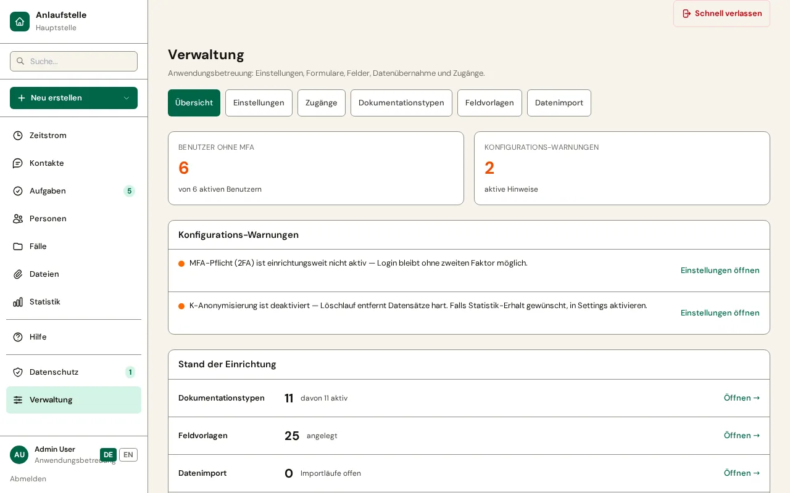

# Screenshots — Anlaufstelle

> **[English version](screenshots.en.md)** · zurück zur [README](../README.md)

Ein vollständiger Rundgang durch Anlaufstelle. Alle Bilder stammen aus der
Demo-Umgebung (`make seed --scale=medium`) und zeigen ausschließlich
pseudonymisierte Beispieldaten.

## Alltag & Dokumentation

### Zeitstrom — das digitale Dienstbuch

### Ereignis erfassen

### Personenliste

### Personenverlauf

### Suche — die vollständige Ergebnisseite

## Fallarbeit

### Fallakte mit Episoden und Zielen

### Schichtübergabe

### Arbeitszentrale — rollenbezogener Einstieg

## Auswertung & Datenschutz

### Statistiken

### Datensatz-Berichte — fertige Auswertungen als Karten

### Datenschutzfreundlicher externer Bericht

### DSGVO-Datenpaket

## Bereichs-Übersichten

### Datenschutz — Betroffenenrechte, Fristen und Nachweise

### Verwaltung — Formulare, Felder, Datenübernahme

## Zugang

### Anmeldung

## Mobil

| Zeitstrom (Mobil) | Arbeitszentrale (Mobil) |
|:---:|:---:|
|  |  |
